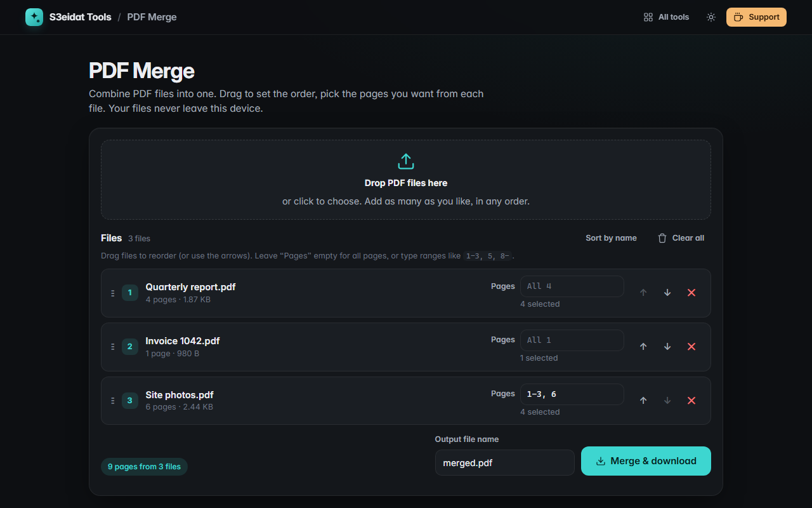

# PDF Merge

> Combine PDF files into one. Free, private, and it runs entirely in your browser.

### ▶ [Open PDF Merge](https://s3eidat.github.io/pdf-merge/)



## Features

- Drop or pick **any number of PDFs** and merge them into one file
- **Reorder** by dragging, with the arrow buttons, or sort by file name
- See each file's **page count and size**
- **Page ranges per file**: `1-3, 5, 8-` (open-ended), or `5-1` for reverse order; leave empty for all pages
- Clear errors for **password-protected/encrypted** or damaged files, which are never merged silently
- Choose the output file name

## Privacy

Your PDFs never leave your device: they are read and merged by JavaScript in this tab. There is no server, no account,
no analytics. The page ships with a strict Content-Security-Policy (`connect-src 'self'`), so the browser itself blocks any
attempt to send data anywhere.

## Run it yourself

It's plain HTML, CSS and JavaScript with no build step:

```bash
git clone https://github.com/s3eidat/pdf-merge
cd pdf-merge
python -m http.server 8000
```

Then open http://localhost:8000.

## Credits

PDF editing by [pdf-lib](https://pdf-lib.js.org/) (Andrew Dillon, MIT), shipped in `lib/`.

## Support

If this saved you time, **[buy me a coffee ☕](https://s3eidat.github.io/coffee/)**. It keeps every tool free.

---

Part of **[S3eidat Tools](https://s3eidat.github.io/)**: 100+ free, private tools that run in your browser. MIT licensed.
